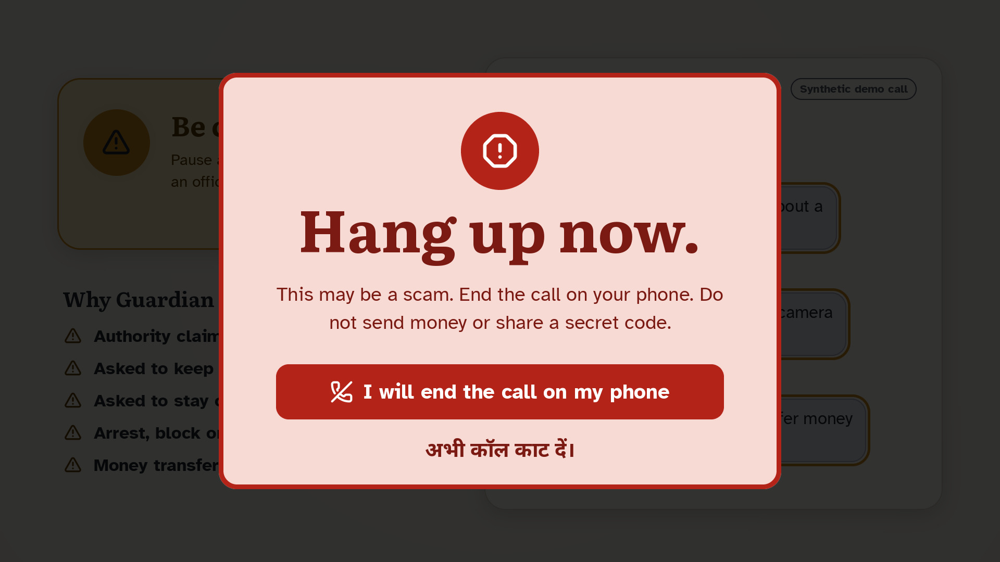

# Scam Guardian

<p align="center">
  <a href="brag-output/brag.mp4"></a>
  <br>
  <a href="brag-output/brag.mp4"><strong>▶ Watch the 60-second demo (brag-output/brag.mp4)</strong></a>
</p>

A senior-first scam-call guardian built for the Gnani Great Indian AI Internship Challenge. A companion device (an old phone or tablet) sits next to the senior's phone during a call on speakerphone. It listens through Gnani's speech recognition, works out whether the caller or the senior is speaking, checks the conversation for scam tactics, and warns with a calm three-level signal (**No warning detected · Be careful · Hang up now**), a spoken warning, and optional reason-only alerts to family.

**MVP languages:** English, Hindi, Tamil and Malayalam, including code-mixed Hinglish, Tanglish and Manglish.

**Status:** a complete local MVP. Everything that can be checked without real phones and real people has been built and tested. What remains is manual testing on real phones and the release gates in [PROGRESS.md](PROGRESS.md). It is not yet validated on real calls.

## How it works

1. **Hearing the call:** browser microphone → server WebSocket → Gnani Prisma v3 realtime STT (code-mix mode), with reconnects, audio-gap tracking and 13-minute stream rotation.
2. **Who is speaking (compulsory voice enrollment):** each turn is labelled *You*, *Caller* or *Unsure* from two acoustic tests (a phone-line frequency signature, and a voice match to the senior's 30-second enrollment), with the words and the AI model as a capped third vote. "You" needs both acoustic tests to agree, and a voice that sounds like the senior but arrives through the phone line is never trusted. The senior's own words count as weak evidence.
3. **Scam detection:** data-only language packs (`src/packs/`) with clause splitting, negation and advice handling, dialogue acts (demand, reported, narration), precise scam patterns plus weighted evidence and an "uncertain" tier, and a compulsory evidence-grounded LLM that can confirm but never decide danger alone.
4. **Warnings and family:** a senior-first interface (three big tabs, one main button, a status card that never relies on colour alone), a large full-screen alert, spoken warnings (cached, streamed), family accounts with reason-only timeline and Web Push, code word, trusted voice, outcome labels, evidence export and a 1930 / cybercrime.gov.in reporting draft.

## Contents

[Solution pitch (PDF)](Solution_Pitch.pdf) · [Run locally](#run-locally) · [Run it on your phone with Cloudflare](#run-it-on-your-phone-with-cloudflare) · [Try it end to end](#try-it-end-to-end) · [Languages](#how-the-languages-work) · [Configuration](#configuration) · [Docker](#docker) · [Verify](#verify) · [Troubleshooting](#troubleshooting)

## Run locally

Requires Node.js 22+ and ffmpeg (ffmpeg is only used for voice-note uploads).

```sh
git clone https://github.com/johhhnnnnyyyyy/Scam-Guardian.git
cd Scam-Guardian
npm ci
cp -n .env.example .env      # then edit .env (see below)
npm start                     # builds the interface, then serves http://127.0.0.1:3000
```

Open <http://127.0.0.1:3000> for the senior's screen and <http://127.0.0.1:3000/family> for the family member's screen. `localhost` counts as a secure page, so the microphone works there without HTTPS.

Minimum `.env`:

```sh
GNANI_API_KEY=your-gnani-key          # speech recognition + spoken warnings
LLM_API_KEY=your-llm-key              # the AI check is compulsory
LLM_MODEL=gemini-2.5-flash-lite       # any fast OpenAI-compatible model
LLM_BASE_URL=https://generativelanguage.googleapis.com/v1beta/openai
DATA_DIR=./data                       # keeps voice prints and family accounts across restarts
```

- No LLM key yet? Set `ALLOW_RULES_ONLY=1` (development only; the server otherwise refuses to start).
- No Gnani key? The rule engine, family view and evidence export still work; live listening, spoken warnings and the voice test need the key.
- Without `DATA_DIR`, everything lives in memory, so **restarting the server forgets the saved voice and the family link**. Set it while testing.
- `npm run serve` starts without rebuilding the interface; `npm run dev:ui` gives live UI editing and proxies the API on port 3000.

## Run it on your phone with Cloudflare

A real test needs two devices: the **companion device** (an old phone or tablet that listens) and the phone the call is on. Phones only allow the microphone on HTTPS pages, so Cloudflare Tunnel gives your laptop a public HTTPS address with no account or router changes.

1. Install `cloudflared` ([downloads](https://developers.cloudflare.com/cloudflare-one/connections/connect-networks/downloads/): `brew install cloudflared`, `winget install Cloudflare.cloudflared`, or the Linux package).
2. Start the tunnel in a second terminal. It prints an address like `https://random-words.trycloudflare.com`:
   ```sh
   cloudflared tunnel --url http://127.0.0.1:3000
   ```
3. Put that address in `.env` (host only in `ALLOWED_HOSTS`, no `https://`, **no spaces after commas**):
   ```sh
   PUBLIC_ORIGIN=https://random-words.trycloudflare.com
   ALLOWED_HOSTS=random-words.trycloudflare.com,127.0.0.1,localhost
   SECURE_COOKIES=1
   DATA_DIR=./data
   ```
4. Restart the server (`npm start`), then open the Cloudflare address on the companion device.
5. Check it works: `npm run test:smoke -- https://random-words.trycloudflare.com`.

A quick tunnel gets a **new address every time it restarts**. Whenever it changes, update `PUBLIC_ORIGIN` and `ALLOWED_HOSTS`, restart the server, and re-open the new address on the companion device (invite links made under the old address stop working). For a permanent address, create a named tunnel on a domain you own (`cloudflared tunnel login`, `cloudflared tunnel create`, then route a hostname to `http://127.0.0.1:3000`) and use that hostname in `.env`.

## Try it end to end

You need: the senior's device (the companion), a second phone for the "caller", and a laptop or phone for the family member. A friend can play the caller. Use only your own voice and invented details, never real bank or OTP data.

### 1. Set up the senior's device

1. Open the server address on the companion device. Choose the language from the menu at the top (or press **Say my language** and say it).
2. Tick the agreement box, then press **Confirm language and agreement**. Allow the microphone when asked.
3. Under **Your information** press **Record my voice** and read the shown text aloud for about 30 seconds, in your normal voice, sitting where you would sit during a call. Pauses are fine; only about 5 seconds of actual speech are required. Do the recording in a quiet room.
4. When it finishes, the card says **Your voice is saved** with the time. Only a small numeric voice measurement is kept; the audio is thrown away. Nothing is trained. The measurement is how Guardian recognises *You* later.

### 2. Link a family member

On the senior's device:

1. Open the **Family** tab, tick *Yes, let my family member see warnings from all my calls*, and press **Create family link**. No call needs to be running.
2. Press **Copy link** and send it to the family member. It works once, for 24 hours. A new link can be made any time.

On the family member's device:

1. Open the link. Choose a **Username** and a **Passphrase** of at least 10 characters (there is no preset account; the family member invents both on first sign-in).
2. After signing in, the **Settings** tab offers:
   - **Turn on alerts**: phone notifications (needs HTTPS and the `ENABLE_PUSH=1` and VAPID settings in `.env`).
   - **Family code word**: a private word the senior is prompted to ask for when a caller claims to be family.
   - **Set up their device from here**: an alternative way to set up the senior's device remotely. A 6-digit code appears on the senior's screen; type it under **Approve their device**.
   - **Your voice for their warnings (optional)**: record the family member's own voice so spoken warnings sound familiar.
3. The family view shows only the *reasons* for each warning (for example "asks for OTP"). It never shows audio or quotes.
4. The senior can switch sharing off in the **Family** tab at any time.

### 3. Run a pretend scam call

1. Put the companion device 30 to 50 cm from the senior's phone. Press **Start listening**.
2. From the second phone, call the senior's phone, answer, and **put it on speaker**.
3. The caller reads a scam script. The screen shows a live chat: your lines labelled **You**, the other person's **Caller** (or **Unsure** when it cannot tell).
4. A calm signal changes between **No warning detected**, **Be careful** and **Hang up now**, with a spoken warning. A family member sees the reasons on their screen. Press **Stop listening** at the end.

Try these invented lines (the caller says them; the senior answers naturally):

| Call | Caller says | Expected |
|---|---|---|
| Harmless | "Hello, it is the pharmacy. Your medicines are ready for pickup." | No warning |
| Lure only | "The government has announced a bonus of ten thousand rupees for pensioners." | No warning yet (an offer alone is not a scam) |
| Scam | "...To credit the bonus I need to verify your account. Please tell me the OTP you will receive now." | Hang up now, family sees "asks for OTP" |
| Bank pressure | "I am calling from your bank. Your account will be blocked today unless you share the OTP." | Be careful or Hang up now |

### 4. Check the voice labels

- Your own sentences should be labelled **You**; the caller's, **Caller**. A voice that sounds like yours but arrives over the phone is never trusted as *You*.
- If your lines show as *Unsure* or *Caller*, record your voice again from the place you will sit on calls, then retry. The noise level and distance matter.
- The thresholds are starting values and have not been calibrated on real calls, so treat labels as a guide.

## How the languages work

The language menu sets the interface, the spoken warnings and the speech-recognition mode. English, Hindi, Tamil and Malayalam are supported, and speech recognition runs in code-mix mode so mixed speech is understood. Scam detection works on both the native script and the Latin-letter forms, including common loanwords such as OTP, bank and account.

To test each one, set the language in the menu, then have the caller say:

| Language | Example scam line |
|---|---|
| English | "Your account will be blocked today. Please tell me the OTP you will receive." |
| Hindi / Hinglish | "Aapka account band ho jayega, abhi OTP bataiye." |
| Tamil / Tanglish | "Ungal account block aagidum, OTP sollunga." |
| Malayalam / Manglish | "Ningalude account block aakum, OTP parayu." |

For each, check three things: the transcript is close to what was said, the speaker labels are right, and the signal reaches **Hang up now** once the OTP or payment request is made. Native-script wording for Malayalam in particular has had only a text-level review, so report any misses. Transcription quality depends heavily on the audio: keep the device close, avoid clipping (turn the phone's speaker volume down a little), and use a quiet room. Guardian shows a notice if the sound is too loud or too quiet.

## Configuration

| Variable | Purpose |
|---|---|
| `GNANI_API_KEY` | Speech recognition and spoken warnings (server-side only). **Rotate the key that was exposed during development.** |
| `LLM_API_KEY`, `LLM_MODEL`, `LLM_BASE_URL` | Required LLM (OpenAI-compatible JSON chat completions). Sends recent transcript excerpts to that provider. |
| `ALLOW_RULES_ONLY=1` | Development only: start without an LLM. |
| `DATA_DIR` | Persist family accounts, senior profiles (incl. voice measurement) and device credentials to an owner-only `state.json`. Sessions, transcripts and audio are never written. |
| `PUBLIC_ORIGIN`, `ALLOWED_HOSTS`, `SECURE_COOKIES=1` | Required for any deployment beyond localhost (HTTPS origin, accepted Host headers, Secure cookies + HSTS). |
| `VAPID_PUBLIC_KEY`, `VAPID_PRIVATE_KEY`, `VAPID_SUBJECT`, `ENABLE_PUSH=1` | Optional family Web Push. |
| `PROVIDER_DAILY_CAP`, `LIMIT_<RULE>=capacity[/seconds]` | Paid-call cap (default 500/day) and rate limits. |
| `METRICS_TOKEN` | Enables `GET /api/metrics` (JSON or `?format=prometheus`) — counters and latencies only, never content. |
| `VOICE_EMBEDDER=sherpa`, `VOICE_MODEL`, `VOICE_MATCH`, `VOICE_NONMATCH` | Optional neural voice print (see `src/voice/sherpa.js`); seniors re-record once after switching. |

## Docker

```sh
docker build -t scam-guardian .
docker run -p 3000:3000 -v sg-data:/data --env-file .env \
  -e PUBLIC_ORIGIN=https://guardian.example.in -e ALLOWED_HOSTS=guardian.example.in scam-guardian
```

Put it behind an HTTPS reverse proxy. The image runs as a non-root user, keeps state in `/data`, has a health check, and shuts down gracefully (state is written on SIGTERM).

## Verify

```sh
npm run test:all               # everything below in one go, plus an end-to-end smoke test on a temporary server
npm test                       # 138 unit and integration tests: engine, languages, attribution, live bridge, API, security, privacy, interface
npm run evaluate               # text evaluation with Wilson intervals; add -- --heldout for the blind set
npm run test:smoke -- https://your-tunnel.trycloudflare.com   # end-to-end checks against your running server or tunnel
npm run test:live -- --enroll my-voice.m4a                   # real speech path: enrollment + a streamed call through Gnani (needs ffmpeg)
```

The test plan is in [docs/TESTING.md](docs/TESTING.md). Results and their limits are in [docs/EVALUATION.md](docs/EVALUATION.md). In short: development sets look strong, but blind held-out sets show the rules alone catch roughly a third to a half of unseen scams. The compulsory LLM is the generalisation layer, and real-call accuracy is still unmeasured.

## Troubleshooting

| Problem | Fix |
|---|---|
| Server stops at start with an LLM message | Add `LLM_API_KEY` and `LLM_MODEL`, or set `ALLOW_RULES_ONLY=1` for development. |
| "Host not allowed" or blank page through the tunnel | The tunnel host is missing from `ALLOWED_HOSTS`, or `PUBLIC_ORIGIN` is wrong. Fix `.env` and restart. |
| Microphone does nothing on a phone | Use the HTTPS Cloudflare address, not a plain `http://` LAN address, and allow the microphone. |
| "Please keep speaking" or voice not saved | Read the full text, in a quieter room, closer to the device. The message states how many seconds the server received. |
| Voice or family link vanished after restart | Set `DATA_DIR=./data` so they persist, then record your voice again once. |
| Family invite link does not open | The tunnel address changed, or the link is over 24 hours old. Make a new one. |
| Nothing is transcribed | Check `GNANI_API_KEY`, the speaker volume and that the call is on speaker. |

## Privacy and safety

No audio is stored. Transcripts live only in memory for the session (at most 60 minutes). Family alerts carry tactic labels, never quotes or audio. The senior can download or delete everything from the main screen; family members can delete their own accounts. The notice is at `/privacy`, and the compliance checklist is in [docs/COMPLIANCE.md](docs/COMPLIANCE.md). The app cannot end a cellular call, block payments or identify callers, and "No warning detected" never means a caller is verified. **Get legal advice on transcribing the remote caller before any pilot.**

Read [PRD.md](PRD.md), [DESIGN.md](DESIGN.md), [CONTEXT.md](CONTEXT.md), [docs/API.md](docs/API.md) and [docs/DECISIONS.md](docs/DECISIONS.md) before making product changes.
